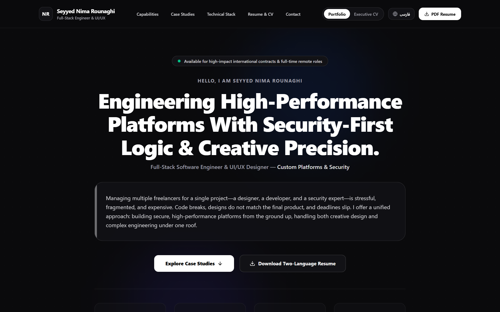
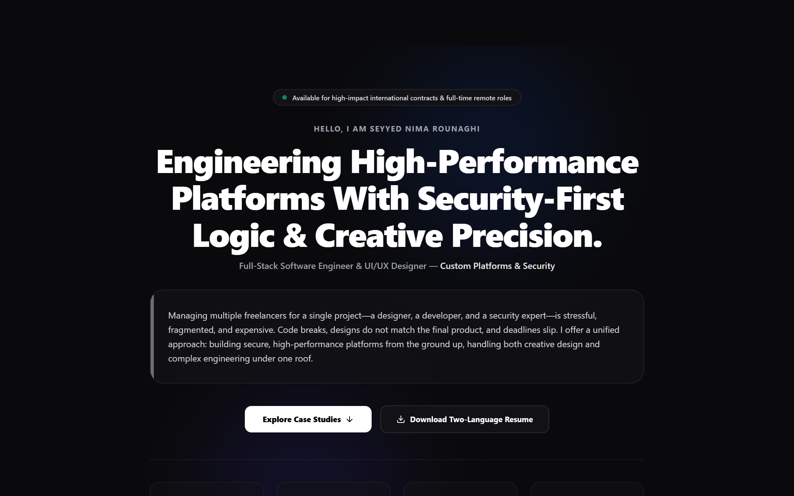
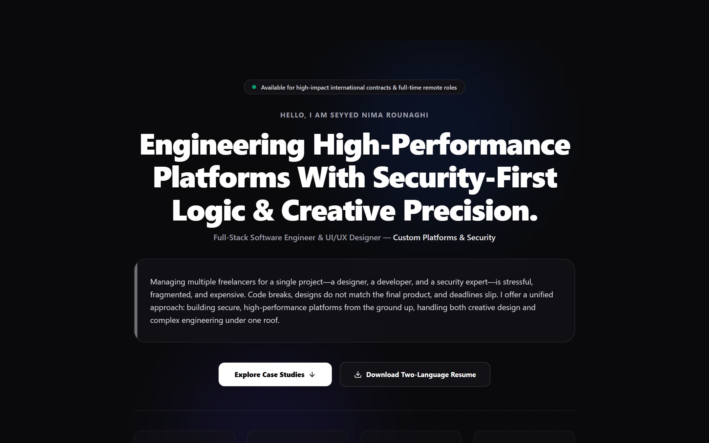
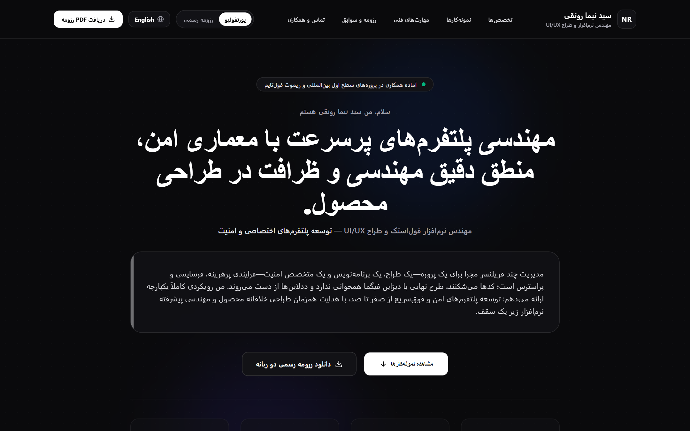

# Seyyed Nima Rounaghi — Flagship Portfolio & Executive Resume

A bespoke, production-grade international digital portfolio and executive resume engineered with **React 19**, **Vite**, and **Tailwind CSS v4**. Features a dual-mode layout (Interactive Portfolio & Executive CV), full bilingual support (**English & Persian**) with dynamic RTL/LTR font rendering, and an automated vector-rendered **A4 PDF Resume Generator**.

**Live Web Portfolio**: [https://lxlnimalxl.github.io/nima-rounaghi-portfolio/](https://lxlnimalxl.github.io/nima-rounaghi-portfolio/)  
**Download Unified Two-Language PDF**: [Seyyed_Nima_Rounaghi_Resume.pdf](./Seyyed_Nima_Rounaghi_Resume.pdf)  
**GitHub Repository**: [https://github.com/lxlnimalxl/nima-rounaghi-portfolio](https://github.com/lxlnimalxl/nima-rounaghi-portfolio)

---

## Visual Showcase

| 01. Executive Hero Overview (EN) | 02. Core Capabilities & Services |
| :---: | :---: |
|  |  |
| **03. Flagship Case Studies Gallery** | **04. Executive CV & Work Experience** |
|  |  |
| **05. Bilingual Persian Experience (فارسی)** | **Unified 4-Page PDF Resume** |
|  | Complete English (pp. 1-2) + Persian (pp. 3-4) Vector Print |

---

## Architectural Pillars

### 1. Unified Value Proposition & Positioning
- **The Problem**: Managing multiple fragmented freelancers (designer, backend developer, security auditor) causes miscommunications, broken contracts, deadline slippage, and design-to-code drift.
- **The Solution**: A unified design-engineering model handling creative user experience (Figma systems) and full-stack software development (React 19, Python, Django 5 REST Framework, Linux, and OWASP security) under a single technical partner.

### 2. Core Service Capabilities
1. **Custom Platform & Web App Development**: Scalable SPAs and SaaS platforms with component modularity.
2. **UI/UX, Logo & Brand Identity Design**: Figma design systems, interactive prototypes, and 100% code fidelity.
3. **Custom Bot Development & Automation**: Scrapers, Telegram/Discord automation, and ETL pipelines.
4. **WordPress Site Creation & Optimization**: Headless architectures, sub-second WooCommerce speeds, and database tuning.
5. **Security Auditing & Penetration Testing**: OWASP Top 10 defenses, CSRF/XSS protection, and Linux server hardening.
6. **Hardware Prototyping (Embedded Systems)**: Microcontroller automation (Arduino, ESP32) with telemetry dashboards.

### 3. Thirteen Flagship Production Case Studies
All thirteen applications feature live demos and public source code:

| Platform | Specialization | Tech Stack | Live Demo | Source Code |
| :--- | :--- | :--- | :--- | :--- |
| **SHOP.CO** | Apparel & Luxury E-Commerce | React 19, Django 5 REST, 3-Angle PDP, Filters, Cart | [Live Demo](https://lxlnimalxl.github.io/shopco-ecommerce-platform/) | [GitHub](https://github.com/lxlnimalxl/shopco-ecommerce-platform) |
| **CinePass** | Cinema Ticket Booking Engine | React 19, Django 5 REST, Curved SVG Seating, QR Pass | [Live Demo](https://lxlnimalxl.github.io/cinepass-cinema-ticket-booking/) | [GitHub](https://github.com/lxlnimalxl/cinepass-cinema-ticket-booking) |
| **Vakil** | International Legal Counsel | React 19, Django 5 REST, Court Fee Algorithm | [Live Demo](https://lxlnimalxl.github.io/vakil-legal-platform/) | [GitHub](https://github.com/lxlnimalxl/vakil-legal-platform) |
| **Ashyaneh** | Accommodation & Hotel Booking | React 19, Django 5 REST, Dual Desktop/Mobile Sim | [Live Demo](https://lxlnimalxl.github.io/ashyaneh-hotel-booking-platform/) | [GitHub](https://github.com/lxlnimalxl/ashyaneh-hotel-booking-platform) |
| **SocioSphere** | Full-Scale Social Platform | React 19, Django 5 REST, Tri-Screen Canvas, Post Feed | [Live Demo](https://lxlnimalxl.github.io/sociosphere-social-platform/) | [GitHub](https://github.com/lxlnimalxl/sociosphere-social-platform) |
| **Cyber.Game** | Gaming & Entertainment Landing | React 19, Tailwind v4, Web Audio API, Confetti | [Live Demo](https://lxlnimalxl.github.io/cyber-game-landing/) | [GitHub](https://github.com/lxlnimalxl/cyber-game-landing) |
| **Tactical Strike** | Sci-Fi Warfare Platform | React 19, Tailwind v4, Operative Dossiers, Audio | [Live Demo](https://lxlnimalxl.github.io/futuristic-tactical-landing/) | [GitHub](https://github.com/lxlnimalxl/futuristic-tactical-landing) |
| **Deluxe Strategy** | Interactive Ludo Board Game | React 19, SVG Board Engine, Turn State Machine | [Live Demo](https://lxlnimalxl.github.io/deluxe-strategy-board-game/) | [GitHub](https://github.com/lxlnimalxl/deluxe-strategy-board-game) |
| **Nevo Hypercar** | Automotive Showcase | React 19, 3D Canvas Rig, Spec Customizer | [Live Demo](https://lxlnimalxl.github.io/nevo-futuristic-car-website/) | [GitHub](https://github.com/lxlnimalxl/nevo-futuristic-car-website) |
| **Planto Botanical** | Curated Plant E-Commerce | React 19, Tailwind v4, Slideover Cart, Search | [Live Demo](https://lxlnimalxl.github.io/planto-interactive-botanical-website/) | [GitHub](https://github.com/lxlnimalxl/planto-interactive-botanical-website) |
| **FinWise** | Wealth & Budget Manager | React 19, Multi-Account Ledgers, Analytics Charts | [Live Demo](https://lxlnimalxl.github.io/finwise-mobile-banking-app/) | [GitHub](https://github.com/lxlnimalxl/finwise-mobile-banking-app) |
| **NovaBank** | Digital Mobile Banking | React 19, Card Stack Carousel, Quick Transfer | [Live Demo](https://lxlnimalxl.github.io/novabank-mobile-banking-app/) | [GitHub](https://github.com/lxlnimalxl/novabank-mobile-banking-app) |
| **Nexcent Agency** | Corporate B2B Platform | React 19, Tailwind v4, Metric Counters | [Live Demo](https://lxlnimalxl.github.io/nexcent-agency-landing-page/) | [GitHub](https://github.com/lxlnimalxl/nexcent-agency-landing-page) |

---

## Two-Language Unified PDF Resume

The project generates a single, print-ready document (`Seyyed_Nima_Rounaghi_Resume.pdf`) designed to meet international hiring standards:
- **Pages 1 & 2 (English)**: Executive Profile, Core Capabilities, Technical Toolkit, Professional Experience, Academic Education, and Production Portfolios.
- **Pages 3 & 4 (Persian)**: رزومه رسمی فارسی با فونت استاندارد وزیرمتن، چیدمان دو ستونه راست‌به‌چپ، سوابق تحصیلی، گواهینامه‌های بین‌المللی و جدول پروژه‌ها.

To regenerate the PDF at any time:
```bash
npm run generate-pdf
```

---

## Local Setup & Development

```bash
# Clone the repository
git clone https://github.com/lxlnimalxl/nima-rounaghi-portfolio.git
cd nima-rounaghi-portfolio

# Install dependencies
npm install

# Start development server
npm run dev

# Build for production
npm run build

# Generate high-resolution PDF resume
npm run generate-pdf
```

---

## License
MIT License. Crafted by [Seyyed Nima Rounaghi](https://github.com/lxlnimalxl).
